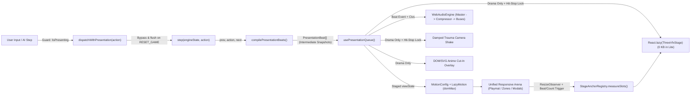

# Duel Masters Battle Arena v2 (`Lite` + `Anime Drama`) — Formal Design Specification

**Date:** 2026-11-27  
**Status:** Approved for Phased Implementation  
**Target Modules:** `web/src/App.tsx`, `web/src/components/duel/*`, `web/src/presentation/*`, `web/src/audio/*`, `web/src/vfx/*`

---

## 1. Architecture & Data Flow

Core rules inside `web/src/engine/*` (`reducer.ts:step`) remain 100% pure, synchronous, and deterministic, keeping all `365+` engine tests isolated from visual concerns. `DuelArena.tsx` splits state into:
- **Canonical Engine State (`engineState`)**: Updated immediately by `step(prev, action)`.
- **Presented View State (`viewState`)**: Driven sequentially through intermediate snapshots (`PresentationBeat[]`) queued synchronously inside an **atomic dispatch wrapper** (`dispatchWithPresentation`), preventing React StrictMode double-enqueueing or stale effect diffs.



---

## 2. Visual Mode Selection & Fallback Policy

| Condition | Default Mode | Override / Runtime Behavior |
|---|---|---|
| `localStorage['dm_visual_mode']` set (`'lite'` \| `'drama'`) | Saved preference (re-checks WebGL2 if `'drama'`) | Instant swap via in-match `UtilityCornerPill` (`Lite \| Drama`) |
| `prefers-reduced-motion: reduce` | `'lite'` | Disables trauma shake & dramatic motion bursts even if inspected |
| Viewport `< 1024px` (mobile / compact tablet) | `'lite'` | User may toggle to `'drama'` mid-match |
| Viewport `>= 1024px` AND `canvas.getContext('webgl2')` | `'drama'` | Auto-falls back to `'lite'` cleanly on init error or `webglcontextlost` |

Switching modes mid-turn flushes any remaining animation queue (`flush()`) onto `viewState = canonicalState` while keeping `engineState`, mana payment staging (`manaPaymentCandidate`), and active interactions (`pendingInteraction`) completely intact.

---

## 3. Atomic Dispatch & Async Presentation Queue (`web/src/presentation/`)

### 3.1 Core Interfaces
```ts
export type VisualMode = 'lite' | 'drama';

export type PresentationEventType =
  | 'DRAW'
  | 'CHARGE_MANA'
  | 'SUMMON_CREATURE'
  | 'CAST_SPELL'
  | 'EVOLVE'
  | 'DECLARE_ATTACK'
  | 'BLOCK'
  | 'SHIELD_BROKEN'
  | 'SHIELD_TRIGGER'
  | 'CREATURE_DESTROYED'
  | 'GAME_OVER';

export interface PresentationAnchorRef {
  player: 'player' | 'opponent';
  zone: 'deck' | 'hand' | 'manaZone' | 'shields' | 'battleZone' | 'graveyard';
  instanceId?: string;
  shieldIndex?: number;
}

export interface CutInSpec {
  kind: 'EVOLUTION' | 'VORTEX_EVOLUTION' | 'BOSS_SUMMON' | 'SHIELD_TRIGGER' | 'FINAL_BLOW';
  title: string;
  subtitle: string;
  card: CardDefinition;
  civilizations: Civilization[];
}

export interface PresentationEvent {
  type: PresentationEventType;
  actor: 'player' | 'opponent';
  card?: CardDefinition;
  civilizations?: Civilization[];
  source?: PresentationAnchorRef;
  targets?: PresentationAnchorRef[];
  meta?: {
    isVortex?: boolean;
    breakerCount?: number;
    powerDelta?: number;
    isShieldBurn?: boolean;
  };
}

export interface PresentationBeat {
  id: string;
  event: PresentationEvent;
  /** Cloned/intermediate snapshot displayed on screen during this beat. */
  displayState: GameState;
  durationMs: { lite: number; drama: number };
  /** Freeze/pause duration at impact peak (0 in Lite; pauses Three.js effect dt). */
  hitStopMs: number;
  /** Normalized 0..1 trauma impulse for damped camera shake. */
  trauma: number;
  cutIn?: CutInSpec;
}
```

### 3.2 Two-Step Combat & First-Class Spell Rules (`compilePresentationBeats`)
1. **Atomic Enqueue:** `dispatchWithPresentation(action)` computes `next = arenaReducer(engineState, action)` synchronously. For `RESET_GAME`, `TOGGLE_MANA_TAP`, and `UNDO_CHARGE_MANA`, it updates immediately and calls `flush()` / zero-delay tick. For gameplay actions, it calls `compilePresentationBeats(engineState, action, next)` once and hands the resulting beats to the queue.
2. **First-Class `CAST_SPELL`:**
   - `CAST_SPELL` (and Shield Trigger spells via `RESOLVE_SHIELD_TRIGGER`) emits `'CAST_SPELL'` first (card reveal flash + civilization spell VFX while board targets still remain intact), followed sequentially by `'CREATURE_DESTROYED'` or `'SHIELD_BROKEN'` beats if the spell removed creatures or burned shields, before advancing to any triggered follow-up interactions or winner modal.
3. **Clean 2-Step Blocker / Attack Split (No Duplicate Attack VFX):**
   - **Case A — `DECLARE_ATTACK` pauses at `BLOCK_DECLARATION` (`nextState.combatState?.stage === 'BLOCK'`):** Emits **only** `'DECLARE_ATTACK'` (attacker taps and charges energy), surfacing `BlockerModal` once complete.
   - **Case B — `DECLARE_BLOCK(null)` (Pass Block):** Emits **no duplicate `'DECLARE_ATTACK'`**. Immediately plays impact beats: `'SHIELD_BROKEN'` (with `pendingInteraction` held `null` until shatter finishes), optional `'SHIELD_TRIGGER'` cut-in, or battle clash + `'CREATURE_DESTROYED'`, or `'GAME_OVER'`.
   - **Case C — `DECLARE_BLOCK(blockerId)` (Intercept):** Emits `'BLOCK'` (blocker taps & intercept shield spark, keeping both creatures on board) -> `'CREATURE_DESTROYED'` (for defeated creature(s), holding graveyard move until dissolve finishes).
   - **Case D — Unblocked `DECLARE_ATTACK` (`nextState.combatState === null` or resolved in one step):** Emits `'DECLARE_ATTACK'` -> `'SHIELD_BROKEN'` / `'SHIELD_TRIGGER'` or clash -> `'CREATURE_DESTROYED'` / `'GAME_OVER'`.
4. **Evolution Summon (`SUMMON_CREATURE` with `evolvedOn`):** Emits `'EVOLVE'` holding bait creature(s) visible on board during the vortex/cut-in beat before stacking into `newCreature`.

### 3.3 Timing Budgets & Input Locking
| Beat Type | Lite (`ms`) | Drama (`ms`) | Hit-Stop (Drama) | Trauma | Input Lock Policy |
|---|---:|---:|---:|---:|---|
| `DRAW` | `150` | `260` | `0 ms` | `0.00` | Soft |
| `CHARGE_MANA` | `160` | `450` | `0 ms` | `0.12` | Locked during beat |
| `SUMMON_CREATURE` (`< 6000`) | `180` | `520` | `40 ms` | `0.28` | Locked during beat |
| `SUMMON_CREATURE` (`>= 6000`) | `200` | `780` | `70 ms` | `0.45` | Locked + Boss Cut-In |
| `CAST_SPELL` | `180` | `560` | `45 ms` | `0.30` | Locked during beat |
| `EVOLVE` (Std / Vortex) | `220` | `850` | `80 ms` | `0.52` | Locked + Evo Cut-In |
| `BLOCK` | `150` | `450` | `45 ms` | `0.30` | Locked during beat |
| `DECLARE_ATTACK` | `180` | `520` | `75 ms` | `0.48` | Locked during beat |
| `SHIELD_BROKEN` | `200` | `720` | `85 ms` | `0.58` | Locked during beat |
| `SHIELD_TRIGGER` | `220` | `900` | `60 ms` | `0.40` | Locked + Trigger Cut-In |
| `CREATURE_DESTROYED` | `180` | `540` | `50 ms` | `0.36` | Locked during beat |
| `GAME_OVER` | `220` | `900` | `90 ms` | `0.70` | Locked + Final Cut-In |

- While `isPresenting === true`: game-mutating actions and the opponent auto-play `700ms` timer pause cleanly; card hover/inspection, drawer toggles, Mute/Volume, Lite/Drama toggle, and **Tap-or-Spacebar Fast-Forward (`fastForward()`)** stay enabled.

---

## 4. Arena Layout, Controls & Mobile (`390×700` / `390×844`) Ergonomics

### 4.1 Desktop (`1440×900`) — `>= 72%` Playmat Budget
- **Collapsed Top Bar:** `App.tsx` hides the full SaaS navbar during `activeTab === 'duel'`; `DuelArena.tsx` owns `100dvh` (`900px` height) with a compact floating top-right `UtilityCornerPill` (`Builder`, `Audio Mute/Slider`, `Lite | Drama`, `Restart`).
- **Collapsible Side Rails:** Left `CardInspectorPane` preserves `w-72 2xl:w-72` (`288px`) when expanded (per `ui-testing-and-verification.md`) and collapses cleanly to a `40px` icon strip. Right `DuelLogPane` defaults collapsed on desktop to a `44px` edge rail (`Log #N` + expand toggle `L`, opening a `304px` overlay/drawer).
  - **Viewport Area:** `1440 - 288 - 44 = 1108px` (`76.9%` of full `1440×900` viewport; `93.9%` when both rails collapsed).
- **Midline Control Anchor (`MidlineControlAnchor.tsx`):** Right edge of the center battlefield divider hosts a crisp Phase Stepper (`MANA -> MAIN -> ATK -> END`) + primary contextual CTA (`To Main`, `Attack Phase`, `End Turn`, `Direct Attack`) right beside cursor/eyes.
- **Unambiguous Card & Mana UX:**
  - `BattleZoneView`: Adaptive card sizes (`104×146px` at `<=5`, `84×118px` at `6–8`, `72×100px` at `9+`), separated two-tier footer plate (`Name` cleanly above `tabular-nums Power` + breaker pips), keyword micro-icons, staggered Evolution card pips peeking underneath top Evolution cards, and `[data-vfx-id]` attributes.
  - `ManaZoneView`: Rotates ONLY the inner card scan container (`rotate-90`) inside `h-20 sm:h-22` headroom while keeping `LOCK` / `PAY` / `STAGED` badges **upright (`0°`)**.
  - `HandView`: Removes cost circle overlapping top-right card title/printed cost orb; renders reduced-cost pill cleanly above card edge; uses mutually exclusive semantic badges (`CHARGE (+1)` in `MANA_CHARGE`, `PLAY` when affordable, `PAYING X/Y` when actively paying mana). Disabled `Confirm Summon` button meets WCAG AA contrast (`bg-slate-800/90 text-slate-300 border-slate-600`).
  - `CardBack.tsx`: Ornate procedural SVG Duel Masters card back replaces every CSS `"DM"` box across Opponent Hand, Deck Piles, and hidden Zone Selection options.
- **Future Total Player Clock Slot:** Fixed `min-w-[54px] tabular-nums` pill (`"--:--"`) reserved in Opponent HUD & Player HUD (UI placeholder only; zero timer logic implemented).

### 4.2 Mobile (`390×700` & `390×844`) 7-Zone Ergonomics
- Slim `38px` top compact HUD (`Inspector`, `T#`, `YOUR/OPP`, `--:--`, `SFX/Mode`, `Log #N`).
- **Collapsible Mana Strip:** At rest shows summary strip (`2/3` + civ pips + chevron); **auto-expands** smoothly during `MANA_CHARGE` (`!manaChargedThisTurn`) or when `manaPaymentCandidate !== null`.
- **Tap-to-Select Hand Actions:** Tapping any card in `HandView` lifts it and displays persistent bottom action pills (`Summon`/`Cast`, `+1 Mana`, `Inspect`) below the hand tray without overflowing or clipping at `390×700` even when both Mana Strip and Hand Action Bar are simultaneously open.
- **Interrupt Panels & Log Severity:** `BlockerModal` & `TriggerModal` use translucent `bg-slate-950/65` panels with a **`Peek Board`** minimize toggle; `DuelLogPane` tiers logs by severity (`muted` phase/draw vs accented `mana`/`summon`/`combat`/`trigger`/`critical`).

---

## 5. Lazy Three.js VFX Stage & Anchor Caching (`web/src/vfx/`)

- **Zero Lite Footprint:** `ThreeVfxStage` is dynamically imported via `React.lazy` exclusively when `visualMode === 'drama' && !webglFailed`. Vite `manualChunks` isolates `three` into its own async chunk (`0 KB` fetched in Lite).
- **Flex-Safe Cached Anchors (`StageAnchorRegistry`):** Maintains `[data-vfx-id]` DOM elements inside `arenaRootRef`. Executes **0** `getBoundingClientRect()` calls inside `requestAnimationFrame`; instead triggers a single `measureSlots()` pass on `ResizeObserver`, container scroll, beat-start, and zone-count changes so centered flex shifts stay pixel-accurate.
- **On-Demand Loop, `performance.now()`, GLSL3, Hit-Stop & Explicit Disposal:**
  - `rAF` wakes only while `activeEffects.length > 0` and stops when idle (`0% GPU`). Uses clamped `performance.now()` delta (`dt <= 0.1s`, not `THREE.Timer`).
  - During `hitStopMs > 0` on impact frames, effect simulation `dt` freezes cleanly inside `ThreeVfxStage` while camera trauma continues decaying cleanly on rest frames.
  - Every custom ES 3.00 `ShaderMaterial` explicitly sets `glslVersion: THREE.GLSL3` (`SummonPortal`, `EnergyBeam`, `FresnelShield`, `EmberDissolve`).
  - Handles `webglcontextlost` with clean `'lite'` fallback; **on unmount** (e.g., `Drama -> Lite` toggle), explicitly calls `.dispose()` on all geometries, materials, textures, and `renderer.dispose()` + `renderer.forceContextLoss()`.
- **Damped Trauma & Cut-In:** `TraumaViewport` drives `trauma^2` X/Y/Roll wrapper offsets (disabled under `Lite` or `prefers-reduced-motion`). `AnimeCutInOverlay` displays diagonal speed-line SVG/DOM cut-ins for Evolutions, `6000+` summons, Shield Triggers, and Final Blows.

---

## 6. Procedural Web Audio Engine (`web/src/audio/`)

- **Bus Topology:** `Voices -> {SFXBus, UIBus, AmbienceBus} -> MasterGain (gain = slider^2) -> DynamicsCompressorNode (-1 dBTP limiter) -> AudioContext.destination`, plus pre-baked hall `ConvolverNode` reverb & noise buffers.
- **Browser Lifecycle & Anti-Pump Stagger:** Unlocks cleanly on first `pointerdown`/`keydown`, listens to `document` `visibilitychange` (suspending when hidden, resuming when visible), and staggers multi-shield breaks & multi-creature wipes by `55–75ms` while capping concurrent voices (`maxVoices = 8`) so rapid board wipes never distort or pump the compressor.
- **5 Civilization Signatures:** Distinct FM/filter/sub recipes for **Fire** (aggressive saw-FM sweep + noise crackle), **Water** (FM bell + 11Hz vibrato shimmer), **Light** (3-osc detuned brass-choir triad), **Darkness** (ring-mod tritone sub drop), and **Nature** (membrane tom + warm woody pluck), layered cleanly under core Draw, Mana Chime, Weighted Summon Slam, Metallic Clash, Shield Glass Shatter, Trigger Alarm, and Victory/Defeat Fanfare cues.
